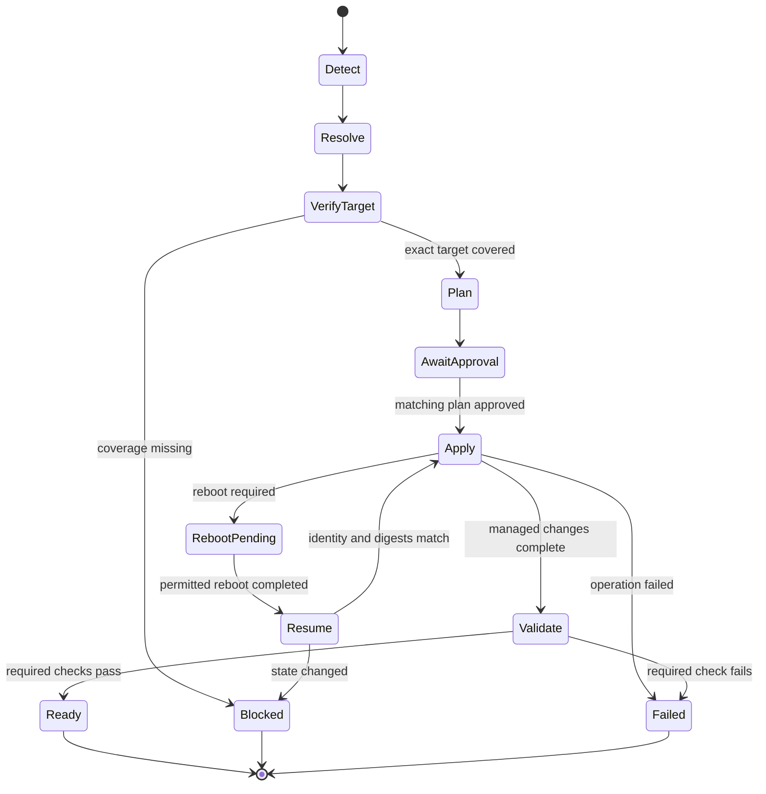
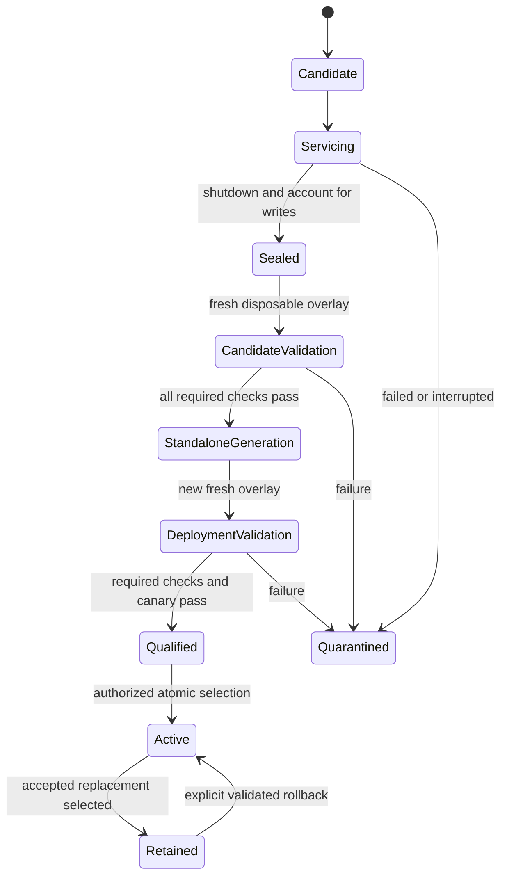
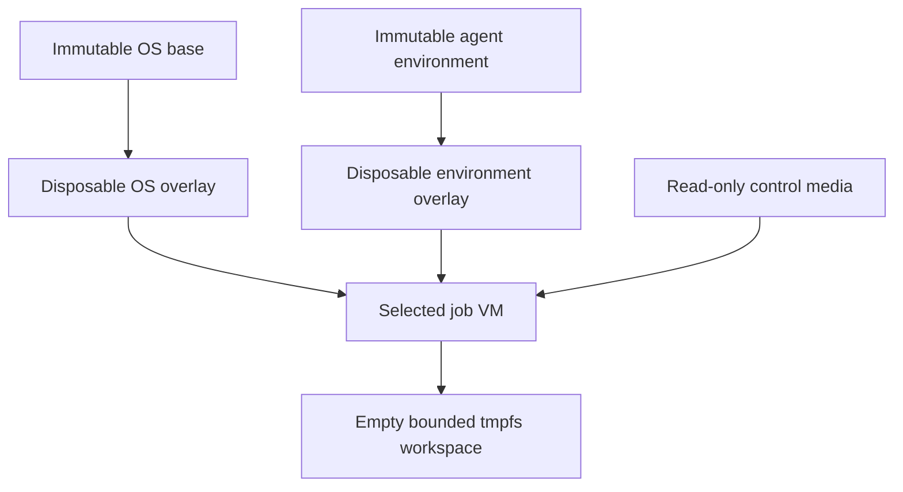

# Linux self-hosted build distribution and runtime integration

Status: **implementation requirements consolidated; implementation open**. This is not an implemented or qualified distribution.

The [grouped implementation backlog](../../TO-BE-IMPLEMENTED.md) merges these requirements with the imported Packer capabilities. It records 36 required items, each linked to a GitHub issue with investigation, implementation, documentation and acceptance work. [Master tracker #1](https://github.com/B0x-world/packer/issues/1) tracks delivery.
Working branch: `B0x-world/packer:release/linux-self-hosted`.
Updated: 2026-10-05 (Australia/Perth).

Baselines: Packer fork `main` at `4bb4b91351b5a62ed4c1df26ff230aecda5bfbe6`; Git CI Builder at `dabb0dec437d84aba4f642da33a931004895c4ba`. Git CI Builder's main branch was rechecked at that revision for this update.

## 1. Scope and authority

Provide a lightweight Linux image-building distribution around Packer, its QEMU plugin and reusable provisioning components, with selectable configurations and complete lifecycle integration. Its design covers host preparation, declared package/configuration state, security, image construction, runtime deployment, servicing, updates, validation, diagnostics and operator interfaces.

Git CI Builder is one selectable consumer profile. Its complete concerns are carried into this design; packaging them here does not move every responsibility into Packer core.

Requirement status:

| Status | Meaning |
|---|---|
| Inherited | Accepted Git CI Builder requirement; preserve it for that profile |
| Extension | Required implementation work added beyond the inherited baseline; tracked in TO-BE-IMPLEMENTED.md and GitHub issues |
| Open | A specific detail remains unresolved; do not invent a production default |
| Implemented | Requires code and relevant execution evidence; this document makes no such claim for the new integration |

Inherited requirements and source links are registered in section 18. Versioned schemas take precedence over older prose where they disagree. The existing schema suite constrains v1 targets and records; portability extensions require explicit new contract versions, not bypasses around those constraints.

The initial target for qualification is Ubuntu 24.04 x64 for host and guest, using the approved Canonical cloud-image source pinned to an exact artifact and SHA-256. This is a target, not a claim of a completed KVM/canary qualification. The broader architecture supports replacing build-host OS, VM guest OS, VM platform and deployment location independently when their compatibility is verified.

## 2. Branches and debugging discipline

| Branch | Purpose | Change flow |
|---|---|---|
| `main` | Protected upstream mirror | Only deliberately authorized upstream synchronization |
| `release/linux-self-hosted` | Maintained distribution and integration baseline | Reviewed topic changes and selected upstream updates |
| `debug/linux-self-hosted` | Proposed diagnostic and fault-reproduction branch | Derive from a recorded release-branch commit; return reviewed fixes through topic changes |
| Topic branches | Bounded implementation changes | Pull requests target the release branch |

The user confirmed that `main` is protected on 2026-10-05. All project work stays on the release branch or branches derived from it. Main protection is not recorded as an outstanding task.

The debugging branch is part of this design; this document update does not create it. It may add instrumentation, test fixtures, controlled console access and diagnostic profiles. Debug builds have distinct identities and output locations, record their instrumentation/configuration differences, and cannot be selected as production generations. Diagnostic access uses disposable validation or maintenance targets without accepting normal jobs.

Reproductions record source/profile/plugin/image digests, exact platform facts, boot timeline, sanitized configuration, console output and failure evidence. Preserve failed sessions under the quarantine rules in section 7. Debugging must not turn off secret redaction or silently weaken production controls. A fix returns to the release branch through review and normal qualification; debug artifacts and accumulated experimental configuration are not promoted wholesale.

## 3. Modularity and responsibility boundaries

| Component | Owns | Does not own |
|---|---|---|
| Packer core in this fork | Template evaluation, build orchestration and plugin loading | Git CI job policy, arbitrary host administration or active-image selection |
| Official QEMU plugin | Temporary build VM, working disks, builder connection and output artifacts | Persistent job VM/session management or Git CI Builder promotion decisions |
| Distribution workflow layer | Profile resolution, host/build plans, backend invocation, servicing integration and evidence collection | Provider-specific shell commands embedded in user configuration |
| OS engines and adapters | Package, configuration, service and non-package artifact state on the declared host or guest | VM ownership, agent registration or promotion policy |
| VM/platform adapters | Owned VM resources, disk relationships, network attachments and lifecycle operations | Package selection or repository identity policy |
| Control transport adapters | Structured requests, readiness, correlation, result delivery and cleanup | Arbitrary command execution selected by job-supplied text |
| Git CI Builder runtime integration | Agent environments, job admission, RAM workspace, session cleanup, image acceptance/promotion and rollback | Packer's in-progress build VM |
| Profiles and definition libraries | Desired capabilities, bindings, versions, policies and validation requirements | Executable provider logic |
| CLI, TUI and GUI | Editing, inspection and invocation of shared operations | Independent copies of planning, validation or apply logic |
| PackerDocs | Semantic reference and source traceability | Runtime policy authority or evidence that a combination works |

One controller owns each VM and mutable artifact at a time. Packer owns its build VM until shutdown and handoff. Runtime or validation adapters subsequently operate separate VMs under explicit ownership records. Image-lifecycle workflows decide whether evidence permits promotion; adapters perform the selected transaction.

Reusable operations are `describe`, `plan`, `apply`, `validate` and `status`, with explicitly advertised optional `repair`, `remove` and `resume`. Contracts remain versioned independently of packaging. The initial implementation can remain a small local application with modules and controlled adapters; a daemon, remote API or universal orchestration framework is not a prerequisite.

### Independent platform selections

| Axis | Declared information | Swap boundary |
|---|---|---|
| Operator/build-host OS | Family, distro, exact release, architecture, package/service mechanisms | Host setup and local execution adapters |
| Deployment-host OS | Exact target and runtime requirements when distinct from the build host | Runtime host-preparation adapter |
| VM guest OS | Family, distro, exact release, architecture, source, boot and guest-service requirements | Guest definitions and preparation adapters |
| VM platform | QEMU/KVM initially; other hypervisors or cloud-native image/VM backends later | Build plugin, artifact adapter and runtime platform adapter |
| Location | Self-hosted or selected cloud account/project/region | Resource ownership, identity, networking and deployment adapter |
| CI provider/profile | Generic Linux base or selected CI agent requirements | Profile and provider-runner adapter |

A supported combination is a verified intersection of these capabilities, not every possible Cartesian product. Qualification covers firmware/boot, architecture, image format, layered storage, device drivers, control/report transport, networking, resource limits, cleanup and credential handling.

A cloud-hosted QEMU build still requires real usable acceleration, including nested virtualization where applicable. A cloud-native Packer builder is a different backend. Neither implies that QCOW2 overlays, host CPU passthrough, QEMU Guest Agent or local control media exist on that platform.

Other backends must provide tested equivalents for the required immutable-source, disposable-write and control-channel semantics, or report the profile as unsupported. Exporting/converting/importing an image creates a separately identified artifact requiring destination validation. Cloud account identity, resource receipts, cancellation and orphan cleanup must be explicit. Existing physical network and cloud-account administration boundaries remain intact.

## 4. Declared configuration and the common package set

The configuration model separates intent, resolution and observation:

| Record | Purpose |
|---|---|
| Shared semantic definition | A capability such as an HTTP client, guest agent or compiler requirement |
| Target binding | Exact distro/release/architecture mapping to package names, versions, services, paths and installation behavior |
| Component | Reusable bundle of requirements |
| Profile | Selected components, target axes and policy |
| Resolved configuration | Complete expanded desired state with origin and digest for each selection |
| Immutable plan | Observed state, ordered changes, ownership, disruptions, required authority and validation |
| Observed inventory and receipts | What was actually installed/configured, by which operation, with exact versions and evidence |

The common package set is an authoritative library of semantic requirements, reused by host, guest and image profiles. It is not one copied package list for every distro and does not mean preinstalling every supported tool.

Definitions inherit at family, distribution and exact-version levels, with specific nodes containing only genuine differences. An inherited definition is usable in normal apply only when verification covers the exact target and complete transitive dependency graph. Unsupported targets require an explicitly selected disposable qualification mode.

Resolution rejects missing references, cycles, conflicts, incompatible versions, ambiguous image matches and unavailable adapter capabilities. Native package dependencies remain with the package manager; capture the simulated and actual transactions. A failed simulation or proposed protected-package removal blocks apply.

Each materialization binding declares storage class, acquisition mechanism, integration, activation/paths, conflicts and required validation:

| Content | Placement |
|---|---|
| OS-integrated package, system library, service, driver or default compiler | OS-base variant |
| Provider runner or declared relocatable SDK/toolchain | Agent environment |
| Checkout, dependency restore, temporary files and build output | RAM workspace |
| Persistent reusable cache | Separate future managed object; absent from the inherited v1 profile |

Track separately: schema version, contract version, definition/library revision, profile revision, source-image identity, package source and exact installed version, artifact checksum, plugin/backend versions, resolved-graph digest and image generation. A version range may express authored intent; the resolved build input records the exact selected version. If pinned content is unavailable, fail or resolve a new reviewed plan rather than silently taking a newer version.

The build record binds the declared package/configuration set to the actual inventory and configuration/service checks. Package presence alone does not prove service state, permissions or hardening. Track drift and validate repair against the same desired-state revision.

### Profiles and lightweight editing

| Proposed profile | Purpose |
|---|---|
| `linux-base` | Minimal common Linux/QEMU build with explicitly selected package capabilities |
| `git-ci-builder` | Common support plus the inherited Git CI Builder OS-base and runtime requirements |
| Diagnostic selection | Additional approved instrumentation for validation/maintenance; never implicit in production |

These are distribution choices, not pre-existing upstream Packer profiles.

JSON remains authoritative with Draft 2020-12 schemas. A YAML editing projection must remain JSON-compatible and round-trip without semantic changes; duplicate keys, anchors, aliases, merge keys, custom tags and implicit dates are prohibited. Inherited arrays use schema-defined by-value additions/removals, not positional patching.

The TUI and GUI select components from the common catalogue, show supported targets/versions, explain inherited values, preview dependency and package changes, and show validation status. Saving produces a new configuration revision; it does not immediately modify a running host or image.

CLI, TUI and GUI use the same resolve, diff, plan, apply and validate operations. The inherited `whiptail` TUI is the initial small client; the required GUI is a tracked extension over the same contract (LSH-008). Start with local file/subprocess integration; a network service is a separate future decision. Each operation remains available non-interactively for scripts and agents.

For the Git CI Builder profile, precedence remains explicit CLI selectors/mode controls, selected config file, system config, then compiled defaults. Environment variables are limited to secret input and documented process-local values. Structured results go to stdout or a declared result path; diagnostics go to stderr/logs.

## 5. Package and image-configuration state machine

The preparation state machine applies to a declared host or guest target. It operates on explicit configuration revisions and ownership records.



Before apply, validate configuration/schema, simulate native transactions, check locks/resources/trust, and bind approval to the immutable plan digest. A changed profile, target, source, definition, dependency graph or observed precondition invalidates the plan.

Apply records progress and ownership receipts around each controlled operation. Resume accepts only matching persisted request, target, plan, profile and definition identities and rechecks actual state. An interrupted package transaction is not assumed complete. Repeated apply must converge without unintended changes; repair only changes owned/adopted state permitted by policy.

These are conceptual workflow states, not additions to the existing result-status enum. Each state/transition must map to versioned runtime records during implementation. Retry/reboot/interruption ceilings require an accepted policy; this diagram supplies no invented numeric limits.

Host preparation produces a ready host. Guest preparation produces candidate contents. Neither directly promotes an image. Image acceptance is a separate state machine:



The canary requirement applies to the Git CI Builder profile. A generic Linux image uses its own declared deployment tests and cannot thereby claim Git CI Builder qualification.

## 6. Security and hardening

Inherited Git CI Builder threat scope is trusted private workflows with job code able to modify everything accessible in its guest. Public multi-tenant or untrusted-fork hosting is not implied.

| Boundary | Required control and evidence |
|---|---|
| Host administration | Preserve unrelated host software/networking; simulate package changes; narrow service-account and virtualization access; distinguish owned, adopted, observed, protected and external state |
| Guest baseline | Minimal declared packages and services; validated accounts, permissions, mounts, kernel settings and prohibited listeners; no undeclared broad hardening/debloating |
| Runner privilege | Locked provider-runner account without unrestricted sudo; root-owned runtime and predefined privileged operations |
| Persistence | Immutable sources; disposable session writes; manifest-declared writable provider paths only; no checkout/build output in persistent environment directories |
| Inputs and provenance | Approved repositories/sources, pinned artifacts and digests, publisher verification where supplied, schema-valid requests and configurations |
| Secrets | Protected single-use token delivery, narrow persistent credential permissions, deletion after acknowledged use/failure, mandatory redaction before retention |
| Control and results | Bound request/session/target identity, freshness, HMAC verification and replay rejection; unknown actions fail closed |
| Lifecycle | No job acceptance until required readiness gates pass; no image promotion from job or debug execution; missing evidence blocks acceptance |

Hardening is declarative and target-specific: each control has an identifier, desired condition, supported targets, owner, failure condition and validation. Profiles can select stricter controls; edits must expose conflicts and changed assurance requirements. A label such as “hardened” is not evidence.

Validate both intended functionality and rejection of prohibited behavior using known-bad fixtures or fault injection. HMAC correlation does not by itself prove that a compromised guest reports truthful state; retain host observations and independent deployment checks.

Inherited v1 does not claim Secure Boot or credential encryption at rest. Those remain separate extensions requiring complete boot/key/recovery designs. The fork must not advertise them based on a configuration toggle.

## 7. Layered QCOW2 images and artifact lifecycle

QCOW2 provides block-level copy-on-write layering; it is separate from Linux OverlayFS. Normal Git CI Builder sessions use **two independent image chains**, not one OS-plus-environment backing chain.



| Object | Contents and mutability |
|---|---|
| OS base | Common packages, guest runtime, dispatcher and service integration; immutable accepted generation |
| Agent environment | Runner binaries/version, registration/configuration and permitted portable tools; immutable source during jobs |
| Maintenance candidate | Writable derivation used only for declared servicing |
| Runtime overlays | New per-session writes for OS and environment; never reused |
| RAM workspace | Volatile job working data; not a disk-image layer |
| Control media | Protected structured request; not general configuration storage |
| Quarantine | Stopped failed/interrupted/orphan state retained for investigation; never attached for normal execution |

A normal session selects one OS base and one environment. Only one active VM may use a registration at a time. UUIDv7 identities distinguish artifacts, candidates and sessions. Ownership records and locks cover every attachment and mutable object.

Each persistent generation has its immutable manifest sidecar with identity, target, provenance, content SHA-256/size, materialized package/capability state, backing relationships and validation references. Recompute complete image digests and sizes under lock for every session; inspect the backing chain and verify manifests. Cached timestamps or prior-session hashes do not satisfy the inherited check.

Canonical manifest digests use the bundled RFC 8785 JSON canonicalization rule. Active selection is an atomic, durable `active.json` transition under the identity lock, binding image, manifest and qualifying-evidence identities. A symlink or rename does not indicate active state. Keep active plus one previous known-good generation per logical image identity; rollback is explicit and auditable.

Seal a maintained candidate, validate through a fresh overlay, flatten to a standalone immutable generation, then validate another fresh overlay before promotion. Candidate and final generation have separately bound evidence. Import/export or repair preserves honest provenance and cannot manufacture an earlier approval.

Environment disks use the inherited ext4/UUID/`GitEnv-<repo9>` identity checks and dynamic mount. Their `provider/`, `state/` and `tools/` directories retain declared ownership; portable tools remain read-only to normal jobs. System-integrated toolchains require an OS-base variant. Storage capacity and resize are planned; resizing occurs through maintenance, never ordinary jobs.

Normal cleanup requires a stopped VM, recovered result/evidence, ownership proof and no active, attached, locked or backing-referenced target. Failed sessions remain read-only quarantined after diagnostic recovery and require explicit operator cleanup. Startup orphan handling first checks that no running or paused VM holds the artifacts. The inherited orphan-eligibility threshold is configurable with a 24-hour default; it is not permission to delete protected or unrecovered artifacts.

Artifact names, directory rules and exact environment identity semantics remain governed by the image storage contract [S3]. Runtime state roots remain:

| Domain | Configuration/state/runtime |
|---|---|
| Host | `/etc/git-ci-builder`, `/var/lib/git-ci-builder`, `/run/git-ci-builder`, logs in `/var/log/git-ci-builder` |
| Guest | Runtime in `/run/git-ci-builder`; selected environment mounted at `/var/lib/git-ci-builder/environment` |

Cloud/image-platform adapters must preserve these logical boundaries or declare incompatibility. Providers without QCOW2 need a separately qualified snapshot/volume implementation; renaming a different image format is not an adapter.

## 8. RAM disk and resource policy

The Git CI Builder workspace is tmpfs at `/run/git-ci-builder/workspace`, recreated empty per session and bound to the provider runner's work directory.

Calculate host reserves, permitted guest vCPU/RAM, guest process-memory reserve and workspace bounds before creating resources. Conceptually:

```text
workspace_limit = clamp(
    configured_fraction * (assigned_guest_ram - guest_memory_reserve),
    configured_workspace_min,
    configured_workspace_max
)
```

Reject inconsistent bounds, insufficient reserves or a minimum that cannot fit; do not use clamping to conceal an impossible plan. Record all inputs and resolved byte values. No fixed large RAM-disk size is assumed.

A tmpfs limit is not preallocated or guaranteed memory: workspace growth competes with compilers and other guest processes. Capacity and memory-pressure checks belong in startup and session monitoring, with declared failure behavior and diagnostic recovery.

Disable guest swap for job sessions. Validate mount identity, permissions, ownership, emptiness and executable output before starting the runner. Use `nodev` and `nosuid`, with `noswap` only where supported and verified; `noexec` would conflict with executing build outputs.

RAM contents and both disk overlays are discarded at successful session end. The profile has no persistent package, compiler, SDK, provider or container cache. A future cache requires its own ownership, size, validation and poisoning policy.

## 9. Runtime, service and image-servicing modes

Mode selection belongs to the protected boot request and shared operation contract. The guest dispatcher authorizes the selected operation before any provider runner starts.

| Mode/action intent | Permitted behavior | Exit condition |
|---|---|---|
| Normal `run` | One job in a fresh session | Correlated result, shutdown and disposable-state cleanup |
| Explicit `run-batch` | Same agent/environment/repository with strict between-job cleanup | Bound reached, operator stop, resource threshold or any degraded/missing/failed cleanup |
| `validate` | Configuration, security and deployment checks; no ordinary job admission | Evidence and controlled shutdown; a canary is a separately authorized validation operation |
| `update-os` | Guest OS/package/config/service changes on a maintenance candidate | Controlled reboot/resume, seal and qualification |
| `update-agent` | Runner/tool/registration-related maintenance as declared | New validated environment generation; registration replacement remains explicit |
| `update-all` | Coordinated OS/artifact/agent maintenance | Compatible candidate set and complete validation |
| `register` | Explicit repository-scoped registration or deliberate replacement | Protected token consumption, recorded identity and validated configuration |
| `maintenance-shell` | Audited diagnostic access without normal runner execution | Time-bounded access revoked before sealing |
| `disable` | Runner suppressed | Declared diagnostics/shutdown behavior |

Action names describe the inherited operation intents; implementation must map them to the versioned request schema rather than introduce undocumented dispatch strings.

The host runtime handles operator requests, plans, locks, VM/image selection, monitoring, evidence and promotion. The guest runtime handles boot validation, environment mounting, workspace creation, guest operations and controlled shutdown. OS service management handles enablement, ordering, restart and health. These are distinct responsibilities.

Guest dispatcher/runtime and systemd units belong in the OS base; provider binaries, registration and credentials belong in the environment. Boot ordering is control validation, environment identity checks, mounts, guest-agent/readiness and applicable security gates, workspace validation, then permitted runner launch. No valid request means no runner, diagnostic recording and shutdown.

The distribution must support both one-shot operator operations and lifecycle integration with the selected guest service manager. A persistent host daemon or remote API is a separate extension, not synonymous with an image-maintenance mode.

Initial session scope is one active VM and one selected environment. Batch defaults remain four jobs, one hour duration and ten minutes idle; missing/stale/degraded cleanup stops the session. Job hooks use the locked runner identity and a narrow privileged interface, and never power off or delete a VM themselves. Provider/hook crashes, lost host correlation or unproven completion cause session termination and diagnostic quarantine.

## 10. Injection, control, reporting and diagnostic channels

Treat these as separate logical channels even when a transport adapter implements several of them. Build-time communicator credentials and access are temporary and must be removed before candidate sealing; provisioning privileges do not carry over to normal job execution.

| Channel | Initial mechanism | Contract and boundary |
|---|---|---|
| Build configuration injection | Resolved HCL/variable inputs plus selected guest provisioners | Fixed source/profile identity; controlled scripts, no arbitrary commands in declarative definitions |
| Boot control injection | Protected read-only media attached before start | Schema-versioned request, request/session/environment identity, allowed action, controlled options and freshness |
| Secret delivery | Protected single-use control material or narrowly defined runtime secret input | No tokens in templates, images, plan/result records or retained logs |
| Readiness/lifecycle control | QEMU Guest Agent where appropriate | Readiness, monitoring and controlled shutdown; not a general job-controlled remote shell |
| Operation/result reporting | Structured guest result retrieved through the control adapter | Identity/HMAC/freshness validation, evidence references, acknowledgement and bounded retrieval |
| Diagnostics | Serial console, host/backend logs and guest diagnostic bundles | Separate from authoritative success records; mandatory redaction and explicit retention policy |
| Every-boot state reporting | Planned channel independent of the provider runner | Report configuration/security/runtime state before job admission; validate freshness, loss and restart behavior |

A request or configuration is parsed as data and never sourced as shell. Each session uses a random single-session HMAC secret, retained only in protected memory/control material and destroyed at session end. Reject invalid HMAC, stale/replayed requests, mismatched identities and unknown actions. Correlated result persistence is mandatory; failure to persist is operation failure.

The out-of-band every-boot reporter is required implementation item LSH-020, already anticipated by Git CI Builder but absent from its v1 functionality. Its transport, authentication lifecycle, payload limits, acknowledgement and loss policy require a versioned contract. Until implemented, retain the inherited validation/readiness gates and report the extended capability as unavailable.

Platform substitutions may use different transports, but must prove equivalent authorization, isolation, freshness, cleanup and job-admission behavior. Cloud metadata or a reachable network socket is not automatically a protected secret/control channel.

## 11. Network configuration

Network intent is declared per phase: build, validation, normal job, maintenance and diagnostics. Resolve attachment mode, owned/adopted resources, address/DNS/time requirements, routes, egress destinations, prohibited lateral paths, listener exposure and enforcement responsibility.

For the inherited profile:

- Normal sessions accept no inbound connections; SSH is disabled.
- Block guest-to-guest and guest-to-management lateral traffic.
- Allow outbound traffic only to required DNS/NTP, GitHub, approved package and approved artifact endpoints.
- Enforce policy outside the guest as well as inside it; absence of required enforcement blocks validation.
- Permit temporary maintenance SSH only through an explicit time-bounded host request, restricted operator identity and retained audit evidence; remove it before sealing.

The local runtime owns/adopts its libvirt network and VM attachment; Packer's build networking is separately resolved. NAT, a bridge or a successful package download does not prove the egress/isolation controls work.

Physical switches, VLANs, routers and perimeter firewalls remain external prerequisites. Cloud network changes are limited to explicitly owned/adopted resources under the selected adapter and plan. Record account/project/network identity to prevent applying a plan in the wrong deployment.

Validation includes permitted endpoint reachability and rejection of prohibited traffic/listeners, during normal operation and after maintenance cleanup. Declare proxies or other deployment-specific requirements explicitly when supported; do not infer them from ambient process configuration.

## 12. Updatability and image servicing

Updates cover the distribution, host dependencies, Packer, plugins, guest OS packages/configuration, external artifacts, guest runtime, validators and provider runner/toolchains.

| Update domain | Method and retained evidence |
|---|---|
| Host/distribution dependencies | Explicit managed-state plan, native transaction simulation, preservation checks, controlled service/reboot handling and recovery procedure |
| Guest OS/runtime | New writable OS candidate from verified source; apply exact declared changes; seal, test and promote a new generation |
| Runner/portable tools | Environment candidate with exact source/version/digest and compatibility against the selected OS base |
| Packer/plugins/platform tools | Explicit dependency operation, compatibility checks and qualification of affected builds; no silent upgrade during a build |
| Configuration/definitions | New revision and resolved-state diff; invalidate stale plans and identify affected images |
| Validators/controls | Qualification against known-good/known-bad corpus, shadow comparison and revalidation before authority changes |

Host updates are not protected by guest QCOW2 rollback. Record a host-specific recovery/reboot plan and stop on protected-state or package-database failures.

Normal startup never installs missing software into an immutable source or promotes job changes. Native package and runner self-update behavior must be reconciled with the selected immutable-image policy. Version discovery may propose changes; accepting them creates a new resolved plan.

Controlled reboot persists progress and resumes only when request/target/plan/profile/definition identities still match. Cancellation leaves an accountable candidate/resource set. Failed updates keep the last known-good generation available; active boot failure does not silently switch generations.

Registration cleanup, deregistration and re-registration are explicit operator operations. Name/labels/version are manifest-bound; the default naming and immutable repository-identity discriminator follow [S1] and [S3]. A display-name change is not a new provider repository identity.

## 13. Build, configuration and release validation

Validation must distinguish valid configuration, supported composition, successful construction and qualified runtime behavior.

| Gate | Required evidence |
|---|---|
| Authored data | Schema validity, immutable identifiers/revisions, permitted overrides, JSON/YAML round trip and secret exclusion |
| Resolution | Exact target coverage, complete dependency graph, version/conflict checks, selected capabilities and provenance |
| Plan | Actual prerequisites, ownership/locks, native transaction simulation, resource bounds, network enforcement and input digests |
| Build | Selected backend/plugin identities, verified source unchanged, provisioner results, shutdown, output format/backing chain and sanitized logs |
| Guest configuration | Actual packages/versions, files, services, users, permissions, mounts, kernel/network controls and absence of undeclared state |
| Candidate | Fresh-overlay boot through the normal deployment path; runtime/hardening checks bound to the sealed candidate |
| Standalone generation | Independent fresh-overlay boot after flattening/conversion, with fresh runtime firmware state and no builder-only dependencies |
| Git CI Builder deployment | Real GitHub Actions canary routed with a unique temporary label, correct runner identity/workspace, cleanup and prohibited-persistence checks |
| Recovery | Reboot/resume, cancellation, failed boot, stale plans/results, orphan/quarantine handling and explicit rollback |
| Distribution release | Qualified profile/platform matrix, reproducible dependency records, packaged schemas, operator documentation and applicable repository CI |

A successful Packer exit, boot or canary alone is insufficient. A declared capability is not proof of implementation. Qualification must bind the exact target tuple, profile, definition graph, image/manifests, dependency versions, controls, validators and evidence.

Each mandatory control names its failure condition and demonstrates detection with a bad fixture, negative test or fault injection. Missing or stale evidence blocks promotion. The inherited v1 manual-verification option requires the control identity, operator, timestamp, evidence and result; it cannot be an undocumented waiver.

Changing mandatory checks or validators invalidates older evidence for affected qualification. A replacement validator is tested and shadowed against the same candidates; explain result differences before switching authority. Revalidate affected images.

Keep unit/schema/contract checks separate from host/VM integration and real provider tests. Static checks cannot certify KVM, firewall behavior, runner execution or safe cleanup. Applicable Go formatting/generation/lint/test targets still apply when implementation touches upstream code; documentation-only changes do not imply a Packer binary or VM test.

## 14. Plugin and adapter management

Manage distinct extension mechanisms explicitly:

| Kind | Examples | Management requirement |
|---|---|---|
| Packer plugin | Official QEMU builder; future cloud-native builders | Declared source, exact selected version/checksum, host compatibility and Packer/SDK protocol compatibility |
| OS/platform adapter | APT, configuration, systemd, runtime QEMU/libvirt, future providers | Versioned operation/capability contract, target coverage and ownership/validation behavior |
| CI provider adapter | GitHub Actions initially | Registration, pinned runner artifact, labels, hooks, job lifecycle and maintenance contract |
| Provisioning helper | Selected imported actions/runner-images functions | Immutable source revision, dependency inventory, wrapper boundary and provenance |

The official QEMU plugin is mandatory in the initial build path: source repository `hashicorp/packer-plugin-qemu`, HCL source `github.com/hashicorp/qemu`, builder type `qemu`. Review its own source/configuration/defaults, failure/cancellation and output behavior at the selected revision. Forking Packer does not include that plugin or the host QEMU binary.

Dependency setup discovers, verifies, installs and records selected plugins. Enable/disable, update and removal are explicit managed operations; active builds pin their dependency set, and referenced/in-use versions cannot be removed beneath them. Retain enough version information for reproducible rebuilds and supported rollback.

Report unsupported operations and missing capabilities before resource creation. Treat executable plugins/adapters as trusted code, not sandboxed data. Configuration selects reviewed implementations; it does not provide arbitrary executable paths or shell fragments.

Imported helpers stay traceable to upstream. The assessed `install.sh` is a Bash function library for downloads/release lookup/checksums; it is not the distribution installer. Project wrappers select functions, require integrity checks and qualify their behavior on the target. Upstream retry constants do not settle the unresolved project retry policy.

## 15. Proposed implementation organization

Keep integration code grouped beneath `contrib/linux-self-hosted/`; the paths below are a design, not generated placeholders.

| Area | Responsibility |
|---|---|
| `bin/`, `interfaces/` | Thin entry point, shared operation API, TUI and later GUI clients |
| `contracts/`, `schemas/` | Bundled versioned interface/data contracts and migrations |
| `libraries/`, `components/`, `profiles/` | Common semantic definitions, exact target bindings and selectable compositions |
| `resolver/`, `state/` | Dependency/target resolution, immutable plans, progress, receipts and evidence identities |
| `workflows/`, `adapters/` | Lifecycle coordination and controlled OS/platform/provider operations |
| `host/`, `templates/`, `provisioners/` | Host setup, Packer backend translation and guest preparation |
| `integrations/git-ci-builder/` | Consumer profile/runtime handoff using versioned Git CI Builder contracts |
| `plugins/`, `upstream/` | Dependency records and selected helper provenance |
| `validation/`, `diagnostics/` | Contract/negative/integration checks and redacted reproduction support |
| `packaging/` | Distribution artifacts, pinned schemas and dependency manifests |

Use shared modules and data before creating separate services or generic plugin frameworks. Preserve upstream Packer behavior; a core or SDK modification requires a concrete capability gap and compatibility review.

## 16. Staged delivery

The stages below sequence the required work. They do not defer or remove requested features from the [implementation register](../../TO-BE-IMPLEMENTED.md#implementation-register). GUI, independent reporting, debugging and OS/platform/cloud substitutions all have open implementation issues. Every item includes investigation of existing/imported code and required documentation changes.

| Stage | Scope | Exit evidence |
|---|---|---|
| 0. Design baseline | Concern coverage, responsibilities, branch policy and source traceability | This document; no implementation claim |
| 1. Configuration foundation | Versioned records, common package set, exact target resolution, plan/diff and initial TUI | Positive/negative fixtures, provenance and interface parity |
| 2. Host and build backend | Installer/preflight, Packer/QEMU plugin management, qualified source and generic base build | Managed host setup, real KVM build, source integrity and artifact inspection |
| 3. Runtime integration | Two image chains, control/result channels, guest services, RAM workspace and network/hardening enforcement | Independent boot and fault tests with the Git CI Builder profile |
| 4. Servicing and recovery | Candidate updates, reboot/resume, validation, promotion, rollback and quarantine | Both image-validation stages and real canary; failures preserve known-good state |
| 5. Diagnostic workflow | Debugging branch/profile, evidence capture and regression transfer | Reproducible failures and verified fixes without production debug leakage |
| 6. Portability and richer interfaces | Additional qualified host/guest/platform/location combinations, GUI and every-boot reporter | Per-combination qualification, shared operation behavior and channel/security tests |
| 7. Release | Package and publish only supported, qualified combinations | Reproducible inputs, traceability, documentation and all applicable gates |

Stages may deliver bounded slices, but deferred prerequisites must remain visible. The broader scope requested here is recorded; it must not be advertised as completed by the first Linux/QEMU build.

Inherited upstream `build`, `Go Test` and `Go Validate` workflows match `release/**`. Review fork release automation before enabling publication or infrastructure tests. A branch push is not authorization to publish or create cloud resources.

## 17. Open details and current implementation limits

The Git CI Builder baseline contains schemas, fixtures, in-memory checks and partial operator/VM code. Its release status is blocked by missing complete runtime/canary evidence; some launch paths do not enforce the recorded release gate. Integration must close those paths rather than treat a status file as enforcement [S9].

Resolve during implementation:

- Exact Packer/plugin/QEMU/source pins and tested compatibility.
- Complete machine-readable configuration and adapter contracts for the expanded platform axes; current v1 target schemas are Ubuntu 24.04-specific.
- Existing B1 exit-code categories, B2 per-operation retry/interruption ceilings and B3 members of security/update/reboot/preservation policy. This design describes responsibilities without inventing those schema members or numeric values.
- Specific GUI implementation and every-boot reporting protocol.
- First additional distro/platform/cloud adapter and its equivalent storage/control/network semantics.
- Host dependency rollback details and operation-specific interruption handling.
- Log retention duration, which is not supplied by the inherited contract. Image retention and orphan thresholds do not define log retention.
- Qualification and distribution prerequisites for consuming Git CI Builder artifacts, including its recorded licensing/release blockers; no new license grant is implied.

Secure Boot, at-rest encryption, persistent caches, ISO/autoinstall, a remote service API, independent engine services and expanded image retention remain separately scoped future work unless explicitly brought into a later stage. A required capability that lacks an implementation returns unsupported/blocked rather than a guessed success.

## 18. Source register and concern coverage

Sources [S1]–[S10] are pinned to the inspected Git CI Builder baseline. This is project requirement traceability, not a new standards-governance subsystem.

| Source | Authority used here |
|---|---|
| [S1] V1 operational contract | Targets, interfaces, VM/workspace, network, secrets, sessions and release gates |
| [S2] Definition standard | Common libraries, target inheritance, bindings, placement, versions and verification |
| [S3] Image storage standard | QCOW2 chains, identities, manifests, candidates, promotion and quarantine |
| [S4] Reusable engines | Responsibilities, operation interfaces and ownership/evidence |
| [S5] OS preparation | Declared package/config/service state and plan/apply/validate/resume |
| [S6] Job execution and cleanup | Single/batch behavior, hooks, session lifecycle and cleanup |
| [S7] Concept and [S8] functionality | Host/guest boundary, boot actions, F01–F17 scope |
| [S9] Implementation status | Existing code/evidence and unresolved release limitations |
| [S10] Log retention | Diagnostic redaction and unresolved retention duration |
| [S11] Configuration schemas and [S12] runtime schemas | Existing authoritative machine-readable records and constraints |
| [S13] Architecture decisions | Current Node operator direction, pinned cloud-image source and metadata contract |
| [S14] Earlier Packer boundary design | Upstream helper assessment and backend handoff |
| [P1] Packer and [P2] QEMU plugin | Separate implementation references to inspect at selected version pins |
| [P3] PackerDocs | Semantic knowledge reference; applicability is distinct from documentation availability |

### Functional coverage

| Git CI Builder concern | Document sections |
|---|---|
| F01 Configuration and repository scoping | 3, 4, 9, 12 |
| F02 Host OS preparation | 3, 5, 6, 12 |
| F03 Guest provisioning/preparation | 4, 5, 12, 13 |
| F04 VM provisioning | 3, 7, 8, 11 |
| F05 VM management | 3, 9, 10 |
| F06 Image-set management | 5, 7, 12 |
| F07 Agent installation | 4, 7, 9, 14 |
| F08 Agent configuration/registration | 9, 10, 12 |
| F09 Job-session execution | 8, 9 |
| F10 RAM workspace | 7, 8 |
| F11 VM control transport | 9, 10 |
| F12 Maintenance | 5, 9, 12 |
| F13 Validation/promotion | 5, 7, 13 |
| F14 Recovery/rollback | 2, 5, 7, 12 |
| F15 Security enforcement | 6, 7, 10, 11, 13 |
| F16 Operator interface | 3, 4, 15 |
| F17 State/status/evidence | 4, 5, 10, 13 |
| Debugging branch and diagnostic workflow | 2, 16 |
| Common package catalogue and version tracking | 4, 12 |
| Plugin/adapter management | 3, 14 |
| Swappable build OS, guest OS, VM platform and cloud/self-hosted location | 3, 14, 16, 17 |
| GUI and independent every-boot reporter | 4, 10, 16, 17 |

Every managed production artifact must carry its appropriate schema-versioned identity, lifecycle, provenance, integrity and relationships. Images and other binaries use digest-bound sidecars; production Markdown uses embedded JSON metadata under the inherited document contract [S13]. Generated catalogues and human-readable summaries do not replace authoritative records.

The previous proposal placed shared build templates and adapters in Git CI Builder. This fork now owns the shared distribution design. Git CI Builder remains the consumer and authority for its runtime/image-lifecycle requirements; implement that integration once through versioned contracts rather than maintaining two diverging copies.

[S1]: https://github.com/B0x-world/Git-CI-builder/blob/dabb0dec437d84aba4f642da33a931004895c4ba/docs/architecture/v1-operational-contract.md
[S2]: https://github.com/B0x-world/Git-CI-builder/blob/dabb0dec437d84aba4f642da33a931004895c4ba/docs/architecture/definition-standard.md
[S3]: https://github.com/B0x-world/Git-CI-builder/blob/dabb0dec437d84aba4f642da33a931004895c4ba/docs/architecture/image-storage-standard.md
[S4]: https://github.com/B0x-world/Git-CI-builder/blob/dabb0dec437d84aba4f642da33a931004895c4ba/docs/architecture/reusable-engines.md
[S5]: https://github.com/B0x-world/Git-CI-builder/blob/dabb0dec437d84aba4f642da33a931004895c4ba/docs/functions/os-preparation.md
[S6]: https://github.com/B0x-world/Git-CI-builder/blob/dabb0dec437d84aba4f642da33a931004895c4ba/docs/job-execution-and-cleanup.md
[S7]: https://github.com/B0x-world/Git-CI-builder/blob/dabb0dec437d84aba4f642da33a931004895c4ba/docs/concept.md
[S8]: https://github.com/B0x-world/Git-CI-builder/blob/dabb0dec437d84aba4f642da33a931004895c4ba/docs/functionality.md
[S9]: https://github.com/B0x-world/Git-CI-builder/blob/dabb0dec437d84aba4f642da33a931004895c4ba/docs/implementation/stage-status.md
[S10]: https://github.com/B0x-world/Git-CI-builder/blob/dabb0dec437d84aba4f642da33a931004895c4ba/docs/log-retention.md
[S11]: https://github.com/B0x-world/Git-CI-builder/blob/dabb0dec437d84aba4f642da33a931004895c4ba/schemas/v1/configuration.json
[S12]: https://github.com/B0x-world/Git-CI-builder/blob/dabb0dec437d84aba4f642da33a931004895c4ba/schemas/v1/runtime.json
[S13]: https://github.com/B0x-world/Git-CI-builder/blob/dabb0dec437d84aba4f642da33a931004895c4ba/docs/decisions-and-open-questions.md
[S14]: https://github.com/B0x-world/Git-CI-builder/blob/5e970e107aa96e70a0310219b74e4e3c36594117/docs/architecture/packer-qemu-responsibility-boundaries.md
[P1]: https://github.com/hashicorp/packer
[P2]: https://github.com/hashicorp/packer-plugin-qemu
[P3]: https://github.com/B0x-world/PackerDocs
